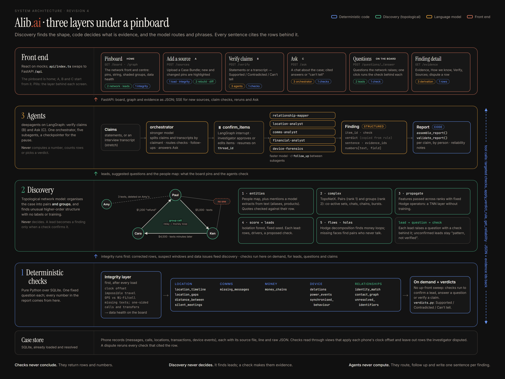

# Alib.ai architecture

This document covers the target design for iteration 1. For a link-by-link account of how every statement is derived and traced back to its source, see [DERIVATION.md](DERIVATION.md). The front-end mock-up in `frontend/` follows these interfaces. Each mock is meant to be replaced by the real component behind the same contract.



*Diagram source: [docs/architecture-diagram.html](docs/architecture-diagram.html). To update it, edit the HTML, open it in Chrome at 1920×1440, and capture a full-size screenshot to `docs/architecture.png`.*

> **Changes in this revision.** The pipeline is now **sweep → triage → brief refines**. It replaced "brief first". The page opens on a briefing, and the investigator's brief sharpens it. The revision also adds:
> - a `signals` table, a `stays` table and an `incidents` table
> - two location checks: `location_timeline` and `location_gaps`
> - four optional checks
> - per-subagent findings files, with follow-up chaining between subagents
> - generator plants for gaps
>
> The acceptance criteria have new entries (§11).

---

## 1. Operating rule

**Agents never compute, and checks never conclude.**

| | Checks (code) | Agents (model) |
|---|---|---|
| What they are | Plain Python functions over SQLite. Each answers **one fixed question**. | LangChain deepagents subagents |
| What they do | Return JSON containing the evidence row ids they used. They compute **every number** the report will contain. | Choose which checks to run and with what parameters. Follow up on results. Read message content. Merge findings. Write the report. |
| What they never do | Draw a conclusion, rank or word anything | Do arithmetic, count rows or invent a row |

Anything that looks like arithmetic in an agent's job is a **code helper the agent calls**. This includes grouping signals by time overlap, counting agreeing checks, or finding clusters of three or more phones. The agent decides what to do with the result: merge, dismiss with a reason, or follow up.

`validate_report()` (code) enforces the rule on output. It drops any statement that:
- has no evidence ids, or ids that don't resolve
- places a *person* somewhere instead of a phone
- uses "lied", "guilty" or similar
- contains a number not copied from a check output
- is longer than one sentence

It allows one repair attempt, then drops whatever still fails.

---

## 2. Pipeline overview

```
 Case Bundle ─► Ingest ─► Case store ─► ① SWEEP (code) ─► signals ─► ② TRIAGE (agents) ─► incidents ─► Opening briefing
                                         every check ×                group · rank · dismiss              (shown on page load)
                                         every pair ×                 · anchor moments                          │
                                         full range                                                             ▼
                                                                       ③ BRIEF REFINES (agents) ◄── investigator's brief
                                                                         match items → signals
                                                                         targeted checks only for gaps
                                                                         re-rank by relevance ─► Report
```

| Stage | Trigger | Actor | Reads | Writes |
|---|---|---|---|---|
| Ingest | Bundle uploaded | code | Case Bundle | case store tables, `stays` |
| ① Sweep | Ingest finished | code only | case store, `stays` | `signals` |
| ② Triage | Sweep finished | agents + code helpers | `signals` | `incidents`, `dismissals`, `anchors`, opening `Briefing` |
| ③ Brief refines | Investigator submits a brief | agents + code helpers | `signals`, `incidents`; new targeted checks | `Report` (brief items matched to incidents, re-ranked) |

---

## 3. Ingest pipeline (`backend/ingest/`)

Input is a Case Bundle v1 (spec: [`schema/case-bundle-v1/README.md`](schema/case-bundle-v1/README.md)). Each stage is a pure function:

| Stage | Does | Output |
|---|---|---|
| `load` | Read the manifest and JSONL files | raw dicts + file/line provenance |
| `validate` | Pydantic models in `schema.py` | errors (fatal), warnings |
| `normalise` | E.164 numbers, tz-aware timestamps, lowercase handles, geofence locations to places | clean rows |
| `resolve` | Identifiers → `person_id` (persons, contacts, social accounts) | `from_person`, `to_person` |
| `store` | Write to SQLite with a global id `<device>:<type>:<record_id>` and `provenance` | case.db |
| `index` | Per-pair contact index; run `location_timeline` for every person → `stays` | ingest report |

New sources only need an **adapter** that writes a Case Bundle.

---

## 4. Case store (SQLite)

**Evidence tables** (one row per phone, each with `id`, `device_id`, `device_owner`, timestamp and `provenance`):
- `persons` (plus `identifiers`, and `orgs` for known businesses)
- `devices`, `contacts`, `messages`, `calls`, `locations`, `transactions`, `device_events`
- `social_accounts`, `social_interactions`

**Derived tables**, written by code and read by checks and agents:

| Table | Columns | Written by |
|---|---|---|
| `stays` | `segment_id, person, kind (stay\|travel\|gap), place, start, end, gap_type, evidence_ids` | `location_timeline` at ingest |
| `signals` | `signal_id, check, people, start, end, evidence_ids, strength, output_json` | ① Sweep |
| `incidents` | `incident_id, signal_ids, people, start, end, n_checks, n_phones, rank, headline, anchor_id?` | ② Triage |
| `dismissals` | `signal_id, reason, rule` | ② Triage |
| `anchors` | `anchor_id, start, end, phones, signal_ids` | ② Triage (via code helper) |

`strength` is computed by the check in code, as a number in 0–1 from a documented per-check rule (see DERIVATION.md §3). Agents never set it.

---

## 5. Checks (`backend/checks/`)

Every check is a pure function. Thresholds are named keyword arguments with the defaults below. Each returns `{check, params, results[], evidence_ids[]}`, and each result can be written as one `signals` row.

### 5.1 Core checks (iteration 1)

| Check | Owner | Logic | Defaults |
|---|---|---|---|
| `location_timeline(person, start, end)` **new** | location | Turns location rows into ordered segments: **stay** (within 150 m for ≥10 min: place, start, end), **travel** (from, to, start, end), **gap** (start, end, gap_type). Stored in `stays`; other location checks read from it. | stay radius 150 m, min stay 10 min |
| `location_gaps(person, start, end)` **new** | location | Periods with no location rows for ≥45 min (normal interval 10 min), each classified (below) | min gap 45 min |
| `distance_between(a, b, start, end)` | location | Haversine per shared slot; min, median, max; label | together ≤150 m for ≥80% of slots; apart if never <1 km |
| `silent_meetings(start, end)` | location | Shared stays within range on repeated occasions with no message or call on any phone | ≤100 m, ≥20 min, ≥2 occasions |
| `missing_messages(a, b, start, end)` | comms | Message on one phone and absent from the other, plus `thread_deleted` on the phone that lacks it | tolerance 2 s |
| `money_chains(start, end)` | financial | A→B then B→C | ≤24 h; 80–100%; first ≥ $500 |
| `synchronised_behaviour(start, end)` | device | ≥N phones with `thread_deleted` or `power_off` in one window; also returns inbound messages before it as trigger candidates | 60 min, 3 phones |
| `deletions(person?, start, end)` | device | All `thread_deleted` events, with counterpart resolved | none |
| `power_events(person?, start, end)` | device | `power_off`/`power_on` pairs with durations | none |
| `identity_match()` | relationship | Links numbers, emails and handles to people across all phones; builds the **people map** the others use | none |

**Gap classification** (`location_gaps`):

| `gap_type` | Condition | Reading | Raised by default? |
|---|---|---|---|
| `powered_off` | A `power_off` event covers the gap | The phone was switched off | Only if it overlaps another signal |
| `location_off` | The phone sent messages, made calls or made transfers **during** the gap | Location was disabled while the phone was in use. Strongest signal. | **Yes** |
| `unexplained` | No activity of any kind | Could be a flat battery or no signal | Only if it overlaps another signal |

Wording rule: a gap is always reported as "**no location data**" and never as proof of intent.

### 5.2 Optional checks (build in this order if time allows)

| Check | Owner | Logic | Defaults |
|---|---|---|---|
| `call_log_mismatch(a, b, start, end)` | comms | A call on one phone that is absent from the other | tolerance 2 s |
| `shared_unknown_number(start, end)` | relationship | A number contacted by ≥2 case people that resolves to no person and no known org | ≥2 people |
| `transfer_after_meeting(start, end)` | financial | A transfer between two people within N hours after their phones were together | ≤6 h; ≥ $500 |
| `contact_went_quiet(start, end)` | comms | A pair with daily contact that stops on a given date | ≥3 consecutive contact days, then ≥2 silent days |

### 5.3 Helpers (code, called by agents)

| Helper | Purpose |
|---|---|
| `run_sweep()` | ① Every check × every pair × full range → `signals` |
| `propose_incidents(signal_ids?)` | Groups signals that share people and overlap in time; returns candidate incidents with `n_checks` and `n_phones` |
| `anchor_moments(window_min=60, min_phones=3)` | Times where signals from ≥3 phones cluster |
| `rank_incidents(incident_ids, relevance?)` | Sorts by (relevance to the brief, if given) → `n_checks` → `n_phones`. Relevance labels come from the agent; the sort is code. |
| `match_brief_item(item)` | Finds signals and incidents that share people and dates with a brief item |
| `contact_graph(people?)` | Edges by channel, for the relations view |
| `get_events`, `search_messages`, `get_coverage` | Raw lookups |

Every check has a unit test against `answer_key.json`: it must return the planted case and must not return any decoy.

---

## 6. Agents (`backend/agents/`, LangChain deepagents)

```python
agent = create_deep_agent(
    model=init_chat_model(os.environ["MODEL"]),          # Anthropic or Bedrock
    tools=[run_sweep, propose_incidents, anchor_moments, rank_incidents, match_brief_item, get_coverage],
    subagents=[relationship_mapper, location_analyst, comms_analyst,
               financial_analyst, device_forensics, report_writer],
    system_prompt=ORCHESTRATOR_PROMPT,
)
```

### 6.1 Subagents and what each owns

| Subagent | Checks it may run | Writes |
|---|---|---|
| `relationship-mapper` | `identity_match`, `shared_unknown_number`, `contact_graph` | `findings/relationships.json` + the **people map** the others read first |
| `location-analyst` | `location_timeline`, `location_gaps`, `distance_between`, `silent_meetings` | `findings/location.json` |
| `comms-analyst` | `missing_messages`, `call_log_mismatch`, `contact_went_quiet`, `search_messages` | `findings/comms.json` |
| `financial-analyst` | `money_chains`, `transfer_after_meeting` | `findings/financial.json` |
| `device-forensics` | `deletions`, `power_events`, `synchronised_behaviour` | `findings/device.json` |
| `report-writer` | none | Merges, ranks (via `rank_incidents`) and words; output passes `validate_report()` |

The findings files live in the deepagents virtual filesystem. Each entry is `{finding_id, signal_ids, check_calls[], statement_draft, evidence_ids, follow_up?}`.

### 6.2 Chaining

The orchestrator reads every findings file after each round. If an entry has a `follow_up` (or the orchestrator spots one), it dispatches a **new task to a different subagent** with the parameters filled in. Every follow-up is logged in the finding's derivation, so the chain is visible in "How we know".

Example (required by acceptance):
1. `location-analyst` finds Ken's `location_off` gap, 15 Apr 14:00–16:30. It suggests a follow-up: "activity during gap".
2. The orchestrator sends that to `financial-analyst`, which runs `get_events(ken, transactions, 14:00–16:30)`.
3. The $4,500 transfer from Ken to Cara at 15:40 falls inside the gap. It is the second link of the S4 money chain, so the two signals join one incident.
4. The orchestrator sends it to `comms-analyst`, which reads Ken's 15:10 message.
5. The merged finding cites all three.

### 6.3 Stage ② Triage (runs on case load, no brief)

1. Read `signals`. Call `propose_incidents()` to get candidate groupings.
2. The agents review the candidates: merge or split them, and **dismiss** signals with an ordinary explanation. Each dismissal records the reason and the rule (for example: "$50 with memo 'lunch', below the $500 money-chain minimum").
3. Call `anchor_moments()`. A cluster from three or more phones becomes an anchor. On the demo case, **17 April around 10:00 is flagged without the system being told about the audit.**
4. Call `rank_incidents()`. Take the top 5. The `report-writer` writes a headline and a "why it matters" for each, using numbers only from the cited signals.
5. Save the `Briefing`.

### 6.4 Stage ③ Brief refines (runs when the investigator submits a brief)

1. Split the brief into items and resolve people and dates. This step is done by the model and logged.
2. For each item, call `match_brief_item()` **first**. If existing signals cover the item, reuse them.
3. Run new targeted checks **only** for items the sweep did not cover. Example: "Paul met Cara in March" → `get_coverage()` → `cannot_tell`.
4. The agent labels each incident's relevance to the brief. `rank_incidents(relevance=…)` then re-sorts.
5. The report-writer assembles the report sections, and `validate_report()` runs.

**Verdicts:**
- `confirmed`: data on at least 2 phones agrees.
- `inconsistent`: the data contradicts the item.
- `cannot_tell`: no data settles the item. The finding cites coverage rows; the agent never guesses.

---

## 7. API (FastAPI, `backend/api.py`)

| Endpoint | Returns |
|---|---|
| `POST /api/ingest` (zip) | `IngestReport`. Ingest kicks off ① sweep and ② triage in the background. |
| `GET /api/case` | `CaseInfo`: people, per-phone counts, places |
| `GET /api/briefing` | `Briefing`: top 5 incidents, anchors, timeline events, dismissed signals. Available as soon as triage finishes; this is what the page shows on load. |
| `GET /api/signals?people=&check=&start=&end=` | Raw `signals` rows, for the "everything the sweep found" view |
| `GET /api/run/stream` | SSE of the case-load run (sweep + triage): `phase`, `agent`, `tool` (check, args, rows, ms), `follow_up`, `log`, `envelope` (an agent's `findings/*.json`) |
| `GET /api/stats/{activity,heatmap,contacts,money,distance,places,volume}` | Chart aggregates computed from rows (see `frontend/src/lib/aggregates.ts`) |
| `GET /api/timeline?people=&start=&end=` | `stays` segments per person (stay, travel, gap with `gap_type`) for the location timeline |
| `POST /api/analyse` (Brief) | SSE stream: `todos`, `subagent` (start, tool, done, `follow_up`) and `report`, with `error` on failure. Uses ③. The last report is cached by brief hash. |
| `POST /api/ask` (question) | SSE stream: `step`, then `answer` with cited findings or `cannot_tell` |
| `GET /api/evidence?ids=` | Rows + provenance grouped by phone; 404 lists unknown ids |
| `GET /api/graph` | Contact graph |

Every `Finding` carries `derivation` (steps including follow-up hops, number traces, validator results, corroboration). Every `EvidenceRow` carries `provenance`. The contract is [`frontend/src/api/types.ts`](frontend/src/api/types.ts), and `backend/schemas.py` mirrors it. New shapes for this revision: `Signal`, `Incident`, `Anchor`, `Dismissal` and `Segment` (stay | travel | gap).

---

## 8. Front end (`frontend/`)

There are two UIs over one case store (`src/state/caseStore.tsx`), with one guided flow: **Ingest → Analyse → Review → Refine → Ask**. Each step unlocks the next, and earlier steps stay viewable.

| UI | Route | Design |
|---|---|---|
| **Pro** (`src/ui/pro`) | `#/pro/<step>` | Analyst dashboard with a left rail stepper, top bar search and a 12-column panel grid. Light/dark themes come from semantic tokens; charts follow the validated dataviz palette (people = categorical slots 1–4; status colours reserved, always with an icon and label). |
| **Noir** (`src/ui/noir`) | `#/noir/<room>` | Case-file / escape-room skin. Five locked rooms: evidence locker, back room (agents at desks, sealed manila envelopes), evidence board (corkboard and string), your theory (notepad → stamped notes), interrogation (typewritten Q&A). |

**Shared by both UIs:**
- **FindingDetail:** Evidence · How we know · Verify · Sources.
- **Evidence views:** keyed by `check_output.kind`, including `gap`.
- **LocationLanes:** the stays/travel/gaps lanes.
- **lib/verify.ts and lib/aggregates.ts.**

**Pro screens:**

| Screen | Panels |
|---|---|
| Ingest | KPIs, rows by table, coverage with gaps, devices, ingest log |
| Analyse | Agent board with envelopes, streaming run log, tool-call trace with follow-up arrows |
| Review | KPI strip, incident table, anchor window, hourly activity, location timeline, time at places, pair distance, heatmaps, contact matrix, money Sankey, dismissed |
| Refine | Brief, progress, agents, results by verdict, next steps |
| Ask | Thread and the case's findings |
| Views | Location timeline (with map), Signals table |

**Data realism:** `src/mock/background.ts` generates a seeded week for every phone. It includes:
- diurnal messaging in conversation bursts
- log-normal call durations
- location fixes every 10 minutes from the stays table
- everyday card spend

Every count and chart is computed from these rows. No activity falls inside power-offs or planted gaps.

The swap point between the mock and the real backend is [`frontend/src/api/index.ts`](frontend/src/api/index.ts).

---

## 9. Synthetic data generator (`data/generate.py`)

The generator is seeded, and writes a Case Bundle plus `answer_key.json`.

**Existing scenarios:**

| ID | Scenario |
|---|---|
| S1 | Deleted messages |
| S2 | Shared alibi |
| S4 | Money chain |
| S5 | Silent meetings |
| S7 | Synchronised behaviour |

**Existing decoys:**
- Amy and Ken once at FreshMart
- $50 "lunch"
- Ken's phone off overnight on 15 April

**New plants:**

| ID | Plant | Expected |
|---|---|---|
| G1 | Ken's phone has **no location rows on 15 Apr 14:00–16:30**, but sends a message at **15:10** and makes the $4,500 transfer to Cara at **15:40** | `location_off`, raised; chains with S4 |
| G1-decoy | Amy's phone has **no location rows and no activity for 50 minutes on 16 Apr, 09:10–10:00** | `unexplained`, **not** raised |
| (existing) | S7 power-offs on 17 Apr | `powered_off`, raised because they overlap S7 |
| (existing) | Ken overnight 15→16 Apr | `powered_off`, not raised |

**Optional-check plants:** for each optional check that gets built, plant one positive and one decoy.

| Check | Positive | Decoy |
|---|---|---|
| `call_log_mismatch` | A Ken→Cara call on 14 Apr 21:05 is on Cara's phone and absent from Ken's | A Paul→Amy call whose copies differ by 1 s (within tolerance) |
| `shared_unknown_number` | Paul and Cara both call +1 555 010 0777, which matches no person or org | Paul and Cara both call Harbor Supply's main line (a known org) |
| `transfer_after_meeting` | Cara→Paul $1,200, memo "refund", at 12:10 on 18 Apr, after the Dock Cafe meeting ends at 09:50 | Paul→Amy $50 "lunch" after their phones were together, below $500 |
| `contact_went_quiet` | Daily Paul↔Ken calls on 13–17 Apr, none on 18–19 Apr | Amy and a non-case friend who are in contact every other day (never daily) |

All plants and decoys are listed in `answer_key.json` with their evidence row ids.

---

## 10. Repository layout (target)

```
data/generate.py              seeded Case Bundle + answer_key.json
schema/case-bundle-v1/        format spec + example bundle
backend/ingest/               load, validate, normalise, resolve, store, index (→ stays)
backend/checks/               location.py (timeline, gaps, distance, meetings), comms.py,
                              money.py, relations.py, device.py, optional.py, helpers.py (sweep, incidents, anchors, rank)
backend/agents/               orchestrator, subagents, triage, refine, writer, validator
backend/api.py                FastAPI
backend/tests/                checks vs answer key, ingest, validator, triage, e2e (slow)
frontend/                     the UI (currently running on mocks)
docs/architecture.png         system diagram
DERIVATION.md                 how every statement is derived and traced to source
```

---

## 11. Acceptance criteria

These are from the PRD, carried forward:
- [ ] `generate.py` is deterministic. Every non-deleted message is on both phones.
- [ ] pytest passes: each check returns its plant and no decoy.
- [ ] The demo brief yields the six expected findings. Every id resolves, and every statement refers to phones, not people.
- [ ] "Paul met Cara in March" returns `cannot_tell`.

New in this revision:
- [ ] The opening briefing appears on page load with no brief entered.
- [ ] The briefing flags **17 April around 10:00** as an anchor moment without being told about the audit.
- [ ] The location timeline shows all four people with stays, travel and gaps.
- [ ] Ken's gap is raised as `location_off`, and Amy's gap is **not** raised.
- [ ] At least one finding in the report comes from a **follow-up chain across two subagents**. On the demo case this is G1 → S4.

---

## 12. Build order

1. Generator and answer key, including G1 and the G1 decoy
2. Ingest, then `location_timeline` → `stays`, then core checks with tests (no model)
3. `run_sweep` → `signals`; code helpers (`propose_incidents`, `anchor_moments`, `rank_incidents`, `match_brief_item`)
4. `/api/case`, `/api/evidence`, `/api/timeline`, `/api/signals`
5. Agents: triage → `/api/briefing`, then brief refines → `/api/analyse` (SSE), with findings files and chaining
6. Front end: briefing as home, location timeline page, gap evidence view, follow-up hops in progress
7. Optional checks, each with a plant and a decoy
8. Cached demo run

Steps 1–4 need no model and can run in parallel with front-end work against the contract in `types.ts`.
