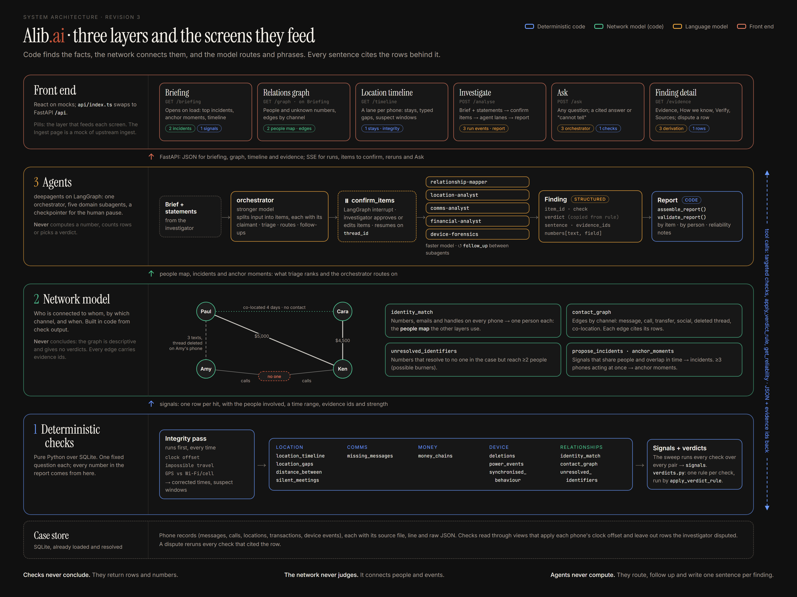

# Alib.ai

*Alibi + AI = **Alib.ai**: it checks whether everyone's story holds up across their phones.*

**Compare phones from the same case. See what's confirmed, what doesn't add up, and what can't be known, with every claim one click from its evidence.**

> Status: **clickable mock-up.** The UI runs on canned synthetic data with a simulated agent run. The real backend (ingest, checks, LangChain deepagents) is designed in [ARCHITECTURE.md](ARCHITECTURE.md) and plugs in behind the same API. Built for HackPrinceton (Arlequin Track 1, LangChain deepagents, Amazon).

---

## Why

Investigators often hold data from several phones in one case. Reading them by hand takes days, and some facts only show up when you compare phones. One example: a message that is still on Paul's phone but has been deleted from Amy's.

Alib.ai does that comparison. The investigator writes a short **brief** in three parts: what they believe, what confuses them, and what they don't know. They can also add **statements** made by people in the case ("I was at home all evening"). An AI agent splits the brief and statements into separate claims, the investigator confirms them, and the agent checks each one against every phone. The report shows, for each person, which of their claims the phones support or contradict. Every finding cites the exact data rows behind it.

## How it works



On case load:

1. **Integrity pass (code only).** Before anything else, the data is checked for signs it can't be taken at face value. Each phone's clock offset is estimated from calls that appear on both phones, and timestamps are corrected before messages are compared. Location fixes that imply impossible travel speeds, and GPS fixes far from the same phone's Wi-Fi or cell fixes, mark that phone and time window as *suspect*.
2. **Sweep (code only).** Every check runs across every pair of people and the whole date range. Each hit is saved as a *signal*, with the rows that support it.
3. **Triage (agents).** Signals are grouped into incidents, and incidents are ranked by how many checks agree and how many phones are involved. Signals with an ordinary explanation are dismissed, with the reason recorded. Moments where three or more phones act together are flagged as anchors. The result is an **opening briefing**, on screen before you type anything.

When you submit a brief or statements:

4. **Parse and confirm.** The agent splits them into separate claims, each attributed to whoever made it. **You approve or edit the list before any check runs.**
5. **Refine (agents).** Each claim is matched to existing signals first. New checks run only for what the sweep didn't cover, and everything is re-ranked by relevance to your questions.
6. **Assemble (code).** The report is put together in code from the structured findings. The only free text an agent writes is a short next-steps paragraph.
7. **Review.** If you dispute a data row, it is excluded, every check that cited it reruns, and findings that changed are marked.

**Agents never compute, and checks never conclude.** Every comparison is a plain Python function that returns the rows it used, and every verdict comes from a rule in code. The agents decide *which* checks answer *which* question and write one plain sentence per finding. A code validator then rejects any sentence that:
- doesn't cite evidence, or cites a row the investigator disputed
- uses a number that didn't come from a check
- has a verdict different from the one the code rule gave
- rests on a suspect window without saying so

## The demo case (synthetic)

Money is missing from **Harbor Supply Co.**, a fictional company. An audit is announced on 17 April at 10:00. Four people say they barely know each other:

| Person | Role |
|---|---|
| Paul Tan | Bookkeeper at Harbor Supply Co. |
| Amy Lim | Paul's friend |
| Ken Ong | Paul's friend |
| Cara Diaz | Supplier to Harbor Supply Co. |

The investigator's brief is pre-filled:
- **Believe:** Paul and Amy were together on the evening of 14 April. Paul and Cara don't know each other.
- **Confused:** Paul sent Ken $5,000 on 15 April and can't explain why.
- **Don't know:** Where did the missing money end up? Did anyone react to the audit announcement?

All people, companies, places and data are invented.

## The agents

They are built with LangChain **deepagents** (`create_deep_agent`): one orchestrator on a stronger model and five domain subagents on a faster one. Every subagent returns structured `Finding` objects, with the verdict copied from a code rule and each number traced to a check-output field. The orchestrator reads them and can **chain** them: one subagent's result triggers a follow-up task for another. There is no report-writing agent, because the report is assembled in code, and no auditing agent, because `validate_report()` does that job.

| Agent | Owns | Checks |
|---|---|---|
| **orchestrator** | Triage on case load; parsing the brief and statements into claims; pausing for the investigator to confirm them; dispatching follow-ups; the next-steps paragraph | `confirm_items`, `propose_incidents`, `anchor_moments`, `rank_incidents`, `match_brief_item`, `get_coverage`, `get_reliability` (code helpers) |
| **relationship-mapper** | Identity matching across phones; the people map the others use; possible burner numbers | `identity_match`, `unresolved_identifiers`, `contact_graph` |
| **location-analyst** | Where each phone was | `location_timeline`, `location_gaps`, `distance_between`, `silent_meetings`, `group_meetings`† |
| **comms-analyst** | Messages and calls | `missing_messages`, `call_log_mismatch`*, `contact_went_quiet`*, `search_messages` |
| **financial-analyst** | Money | `money_chains`, `transfer_after_meeting`* |
| **device-forensics** | Deletions and power | `deletions`, `power_events`, `synchronised_behaviour` |

Every subagent also gets `get_reliability`, `apply_verdict_rule`, `get_events` and `get_coverage`.

\* optional, built if time allows. † stretch.

## The data format

Alib.ai ingests **Case Bundle v1**: one folder per phone, one JSONL file per record type. The record types are contacts, messages, calls, locations, transactions, device events, social accounts and social interactions. People are referenced by phone number, email or handle, and ingest works out who is who.

Any source can be supported by writing an adapter that outputs this format.

- Full spec: [schema/case-bundle-v1/README.md](schema/case-bundle-v1/README.md)
- Example: [schema/case-bundle-v1/example/](schema/case-bundle-v1/example/)

## Report rules

- **Verdicts:**
  - `confirmed`: data on at least two phones agrees.
  - `inconsistent`: the data contradicts the claim.
  - `cannot_tell`: the phones hold nothing that settles it. The agent says so instead of guessing.
- **Every statement cites evidence rows.** Each row shows its id, its source phone and its timestamp.
- **Names stand for phones.** "Amy was at Northgate Mall" means Amy's phone was there. Every report states this once in its assumptions, because a phone's location is not proof of where its owner was.
- **"Inconsistent", never "lied" or "guilty".** The report describes data, and the investigator draws the conclusions. Words like "suspicious", "proves" and "clearly" are banned too.
- **Phone data is assumed genuine.** Spoofing detection is out of scope, and the report says so.

## Trust and transparency

Every finding can be checked by the person reading it. Each one opens with four tabs:

| Tab | What it gives you |
|---|---|
| **Evidence** | The picture: a map, a money chain, a thread diff, a timeline |
| **How we know** | The step-by-step derivation, marking which steps were plain code and which were the language model. It also shows where each number came from, which phones hold each fact, and the validator checks the sentence passed. |
| **Verify** | Your browser recomputes the key numbers from the raw rows, without trusting the check's own output, and shows ✓ or ✗ for each. Here you can also record "I checked this" or "I dispute this". A dispute excludes the row and reruns every check that cited it. |
| **Sources** | For each row: the bundle hash, file, line number and the original JSON line, so you can open the source file and find it |

Alib.ai also **briefs you before you ask.** As soon as the phones are loaded, it sweeps every pair and presents what stands out, ranked, with anchor moments, a week timeline, a per-person location timeline (stays, travel and gaps) and a relations graph. Location gaps are reported only as "no location data". A gap is raised by default only when the phone was clearly in use during it (`location_off`), because phones lose location for innocent reasons all the time. It also lists what it checked and dismissed, and why. You can **ask questions at any time.** Every answer cites its rows or says "cannot tell".

Engineers: see [DERIVATION.md](DERIVATION.md) for exactly how each statement is derived.

## Run the mock-up

Prerequisites: Node 20 or newer.

```bash
cd frontend
npm install
npm run dev
```

Open http://localhost:5173 in Chrome on a laptop-size screen.

Two UIs run over the same case data. Switch between them from either one.

| UI | URL | For |
|---|---|---|
| **Pro**: analyst dashboard, light/dark | http://localhost:5173/#/pro/ingest | Day-to-day use |
| **Noir**: case-file / escape-room | http://localhost:5173/#/noir/locker | Stage demos |

Deep links such as `#/pro/review` or `#/noir/board` load a completed demo case automatically.

### Pro click-path (guided: Ingest → Analyse → Review → Refine → Ask)
1. **Ingest.** Click **Load sample bundle**. You get:
   - KPI tiles
   - rows by table per phone
   - a location coverage chart with gaps hatched by type
   - the devices table and ingest log

   Click **Run analysis →**.
2. **Analyse.** Watch the sweep and triage live:
   - **agent network:** bundle → orchestrator → people map → four domain agents → triage → write-up → **conclusion**. Dots travel along the edges while data moves, and follow-ups show as dashed arcs.
   - **run log:** a streaming list of every call and result
   - **trace:** a Gantt of every tool call, with follow-up arrows

   Click a finished node to open its **envelope** (`findings/*.json`). When every agent is done, the conclusion card lists the ranked incidents.
3. **Review.** The dashboard has:
   - **KPI strip:** four counts
   - **Incidents:** short title plus key numbers; click to open the evidence
   - **Anchor window:** close-up of 17 Apr 08:00–16:00
   - **Activity chart:** hourly, with power-offs shaded and the audit notice marked
   - **Location timeline:** click a block to filter "time at places"
   - **Time at places** and **distance between phones**

   Each chart has **Expand**, which opens its own view.

   Toggle light/dark with ☾ in the top bar.
4. **Refine with brief.** Run the pre-filled brief. Each item is matched to existing incidents, and the money question shows a live follow-up chain. Results are grouped by verdict, and every row opens the finding drawer (Evidence · How we know · Verify · Sources).
5. **Ask.** Try `Was any phone's location off while it was in use?` or `Did Paul meet Cara in March?` (the second returns cannot tell).
6. **Views:**
   - **Activity:** larger chart plus counts per day.
   - **Location timeline:** day or week, with a gap table and a map of the window.
   - **Places:** time at places, by week or by day.
   - **Distance between phones:** all six pairs.
   - **Signals:** every sweep hit, sortable.

### Noir click-path (five locked rooms)
1. **Evidence locker.** Four evidence bags. Click **Log the evidence** and the tags fill in with computed counts.
2. **Back room.** Seven desks type out their checks. Follow-up notes slide between desks, and a sealed manila envelope lands on each desk when its agent finishes. Break the wax seal to read the typed findings.
3. **Evidence board.** A corkboard with:
   - polaroids of the four phones' owners
   - red string by channel
   - incident index cards, with the anchor circled in red marker
   - a ledger strip
   - set-aside notes

   Click a card to open the dossier.
4. **Your theory.** Write the brief on the notepad. Each line comes back as a pinned note stamped HOLDS, DOESN'T HOLD, CAN'T TELL or ANSWERED.
5. **Interrogation.** A typewritten Q&A whose answers carry clickable exhibit tags.

## Status

| Part | State |
|---|---|
| UI: Ingest, Briefing, Investigate, Ask drawer, finding drawer, all evidence views | ✅ Built (mock data) |
| Transparency: derivation chain, number tracing, validator, corroboration matrix | ✅ Built (mock data) |
| Fact-check: in-browser recomputation from raw rows; row provenance | ✅ Built (works on any rows from `/api/evidence`) |
| API contract (`frontend/src/api/types.ts`) | ✅ Defined |
| Case Bundle v1 format and example | ✅ Defined |
| Revision 2: sweep → triage → brief refines; signals, incidents, anchors, dismissals; location timeline and typed gaps; follow-up chaining | ✅ Built in the mock |
| UI revamp: guided flow, Pro dashboard (light/dark) and Noir case-file UI, live agent board + envelopes, charts from computed rows | ✅ Built in the mock |
| Background data: full week of messages, calls, locations, transactions per phone (seeded), counts computed | ✅ Built in the mock (`src/mock/background.ts`) |
| Revision 3: integrity pass, statements, item confirmation, disputes that rerun checks, report assembled in code, hardened validator, multi-seed evaluation | ✅ Designed in [ARCHITECTURE.md](ARCHITECTURE.md); not yet in the mock |
| Synthetic data generator and answer key (gap plant G1 and its decoy, planted clock skew and spoofed GPS, a burner number, innocent noise, statements) | ⏳ Next |
| SQLite case store, integrity pass, checks and tests | ⏳ Next |
| deepagents orchestrator, subagents, briefing and Ask | ⏳ Next |
| Report assembly, validator, reviews and reruns | ⏳ Next |
| FastAPI with SSE | ⏳ Next |
| Multi-seed evaluation (precision and recall per check) | ⏳ Next |
| Ingest pipeline from Case Bundle v1 | Upstream; out of scope for this build |

**Open questions:**
- Does Arlequin accept a fully synthetic case for Track 1?
- Which models will the agents use: Anthropic API or Amazon Bedrock? They are configurable through the `ORCHESTRATOR_MODEL` and `SUBAGENT_MODEL` env vars.

**Decided:** the build runs on the synthetic case for now. [data/README.md](data/README.md) recommends MSAB 2026 as a later real case; it needs a Case Bundle adapter (ingest), which is out of scope for this build.

## Repo layout

```
README.md                  you are here
ARCHITECTURE.md            full engineering design
DERIVATION.md              how every statement is derived and traced to source
docs/architecture.png      system diagram (source: docs/architecture-diagram.html)
data/README.md             which real multi-phone case to use; recommends MSAB 2026
data/datasets/             one page per candidate dataset, plus schema dumps
data/scripts/              fetch phone databases cheaply, list their tables
schema/case-bundle-v1/     ingest format spec + example bundle
frontend/src/
  api/types.ts             the API contract (shared shapes)
  api/index.ts, mock.ts    swap point: mock today, FastAPI later (incl. analyseCase run stream)
  mock/                    planted scenarios (data.ts), seeded background week (background.ts),
                           stays (segments.ts), signals/incidents (signals.ts), run script (run.ts)
  lib/                     aggregates.ts (chart series), verify.ts (in-browser recompute), format.ts
  state/caseStore.tsx      one case-flow store shared by both UIs
  components/              shared finding detail (4 tabs), evidence views, location lanes
  ui/pro/                  analyst dashboard: shell, steps/*, charts, envelope drawer, Ask panel
  ui/noir/                 case-file UI: locker, back room, board, theory, interrogation
```

These are planned and not yet created: `data/generate.py` (the synthetic generator), `backend/` (case store, integrity pass, checks, agents, report, API and tests) and `eval/` (multi-seed evaluation). See [ARCHITECTURE.md](ARCHITECTURE.md) §13.
